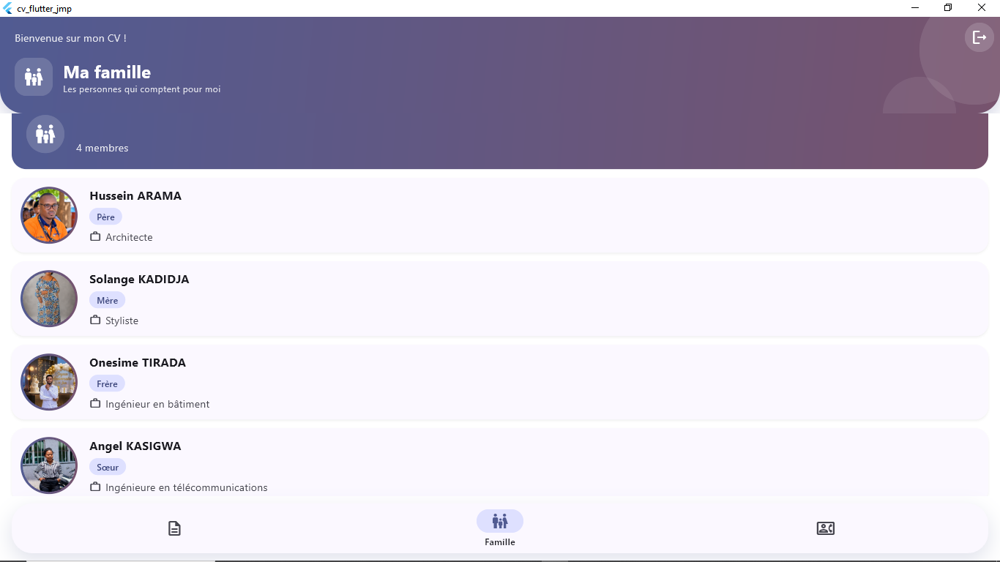

# Mon CV — Application Flutter (TP2 : API REST & authentification)

Application mobile présentant mon CV, ma famille et mes coordonnées.
Réalisée par **Jérémie Malik Paluku**.

Cette version (TP2) gère **dynamiquement** les membres de ma famille grâce à une **API REST**
reliée à une base de données **MySQL**, avec une **authentification réelle** (plus de connexion simulée).

## 🎥 Vidéo de démonstration

COLLE_ICI_LE_LIEN_https://github.com/user-attachments/assets/...

## Fonctionnalités

- Création de compte et connexion vérifiées par l'API (mot de passe chiffré dans la base)
- Session conservée après fermeture de l'application, déconnexion depuis l'en-tête
- Famille : ajout (avec photo), consultation (liste + détail), modification, suppression
- Navigation par barre inférieure (CV, Famille, Contact)
- Coordonnées cliquables : appel, SMS, e-mail, carte, LinkedIn, GitHub
- Messages d'erreur clairs (serveur injoignable, champs invalides, email déjà utilisé…)

## Captures d'écran (TP1)

| Connexion | CV | Famille | Contact |
|---|---|---|---|
|  |  |  |  |

## Lancer le projet
```bash
flutter pub get
flutter run
```

Identifiants de test : `jmp` / `jmp12129`