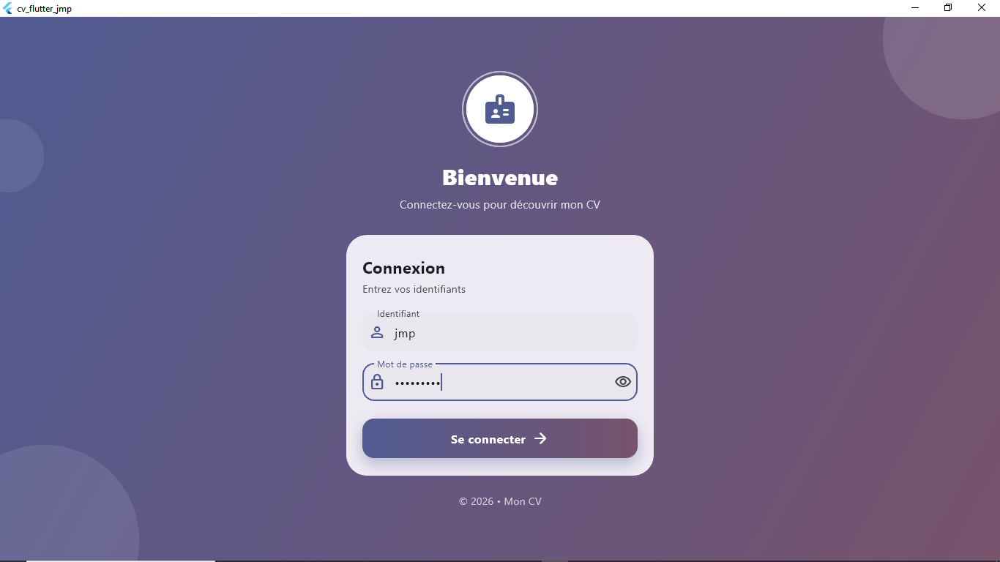
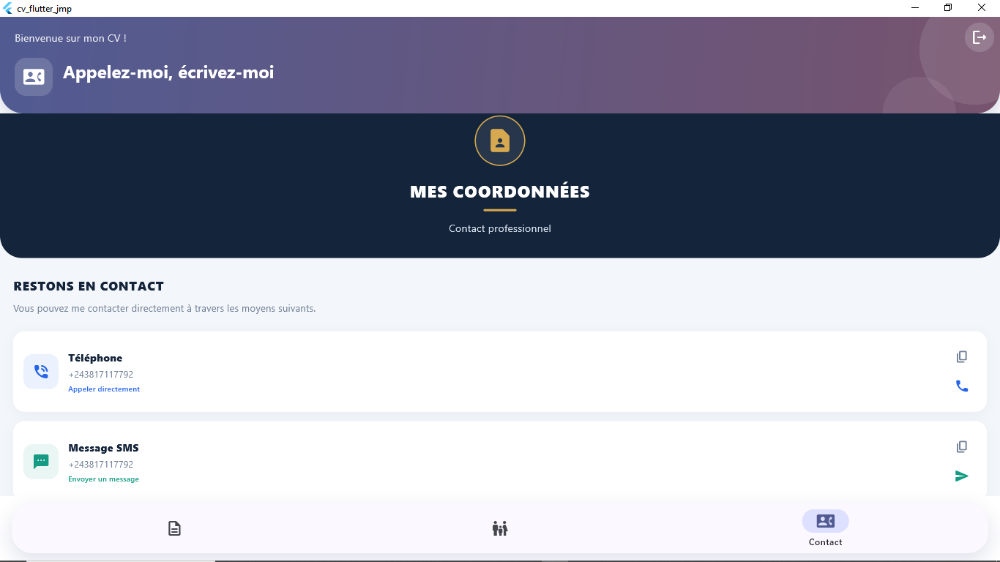

# Mon CV — Application Flutter (TP2 : API REST & authentification)

Application mobile présentant mon CV, ma famille et mes coordonnées.
Réalisée par **Jérémie Malik Paluku**.

Cette version (TP2) gère **dynamiquement** les membres de ma famille grâce à une **API REST**
reliée à une base de données **MySQL**, avec une **authentification réelle** (plus de connexion simulée).

## 🎥 Vidéo de démonstration

COLLE_ICI_LE_LIEN_https://github.com/user-attachments/assets/...

## Fonctionnalités

- Création de compte et connexion vérifiées par l'API (mot de passe chiffré dans la base)
- Session conservée après fermeture de l'application, déconnexion depuis l'en-tête
- Famille : ajout (avec photo), consultation (liste + détail), modification, suppression
- Navigation par barre inférieure (CV, Famille, Contact)
- Coordonnées cliquables : appel, SMS, e-mail, carte, LinkedIn, GitHub
- Messages d'erreur clairs (serveur injoignable, champs invalides, email déjà utilisé…)

## Captures d'écran (TP1)

| Connexion | CV | Famille | Contact |
|---|---|---|---|
|  |  |  |  |

## Technologies

- Flutter / Dart — paquets `http`, `shared_preferences`, `image_picker`, `url_launcher`
- API REST PHP : https://github.com/espoirbaraka/api-test
- Base de données MySQL (XAMPP)

## Endpoints de l'API utilisés

| Méthode | Endpoint | Utilisation dans l'app |
|---|---|---|
| POST | `/accounts/register` | Créer un compte |
| POST | `/accounts/login` | Se connecter |
| GET | `/famille-membres` | Liste des membres |
| GET | `/famille-membres/{id}` | Détail d'un membre |
| POST | `/famille-membres` | Ajouter un membre |
| PUT / POST | `/famille-membres/{id}` | Modifier (POST si nouvelle photo) |
| DELETE | `/famille-membres/{id}` | Supprimer un membre |

## Installation

### 1. API et base de données
1. Installer XAMPP, démarrer **Apache** et **MySQL**.
2. `cd C:\xampp\htdocs` puis `git clone https://github.com/PALUKU-MALIK-JEREMIE/api-test.git`
3. Dans phpMyAdmin (http://localhost/phpmyadmin) : créer la base `api`, puis importer `api.sql`.
4. Vérifier dans le navigateur : http://localhost/api-test/public/famille-membres

### 2. Application Flutter
1. `git clone https://github.com/PALUKU-MALIK-JEREMIE/cv_flutter_jmp.git`
2. `flutter pub get`
3. Adapter l'adresse de l'API dans `lib/config/api_config.dart` :
   - émulateur Android : `http://10.0.2.2/api-test/public`
   - téléphone réel : `http://<IP du PC>/api-test/public`
   - appliction windows : `http://127.0.0.1/api-test/public`
4. `flutter run`, puis créer un compte depuis l'écran de connexion.

## Structure du code

```
lib/
├── config/     # adresse de l'API
├── models/     # FamilleMembre
├── services/   # appels à l'API (authentification, famille)
├── data/       # données du CV
└── pages/      # écrans (connexion, inscription, accueil, CV, famille, contact…)
```