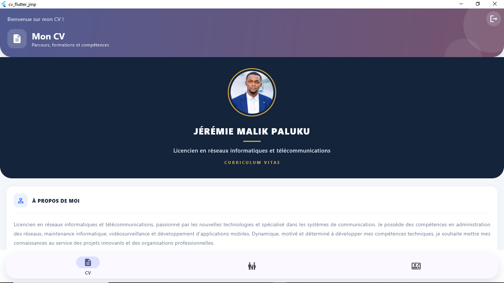

# Mon CV — Application Flutter

Application mobile présentant mon CV, ma famille et mes coordonnées.
Réalisée par **Jérémie Malik Paluku**.

## Fonctionnalités
- Connexion par identifiant et mot de passe
- Navigation par barre inférieure (CV, Famille, Contact) et bouton de déconnexion
- Coordonnées cliquables : appel, SMS, e-mail, carte, LinkedIn, GitHub

## Captures d'écran

| Connexion | CV | Famille | Contact |
|---|---|---|---|
|  |  |  |  |

## Lancer le projet
```bash
flutter pub get
flutter run
```

Identifiants de test : `jmp` / `jmp121299`
